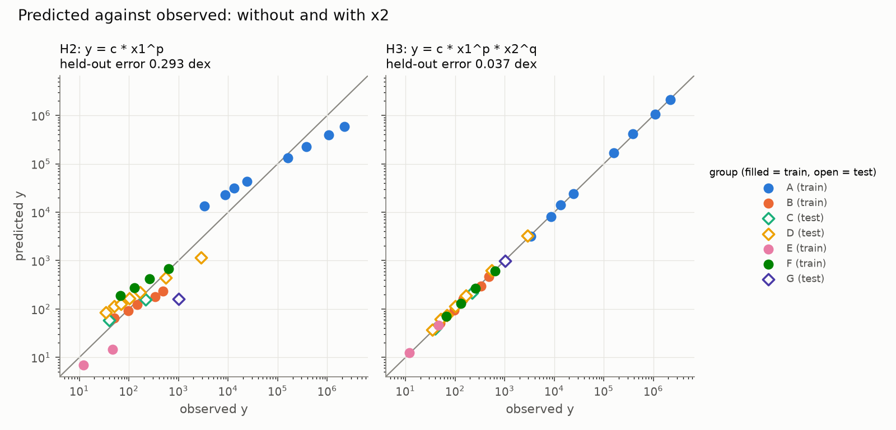

# D-Lab AI Co-Scientist Workshop

[](https://dlab.datahub.berkeley.edu/hub/user-redirect/git-pull?repo=https%3A%2F%2Fgithub.com%2Fdlab-berkeley%2FAI-Science-Coscientist&urlpath=lab%2Ftree%2FAI-Science-Coscientist%2F&branch=main)
[](https://mybinder.org/v2/gh/dlab-berkeley/AI-Science-Coscientist/main?urlpath=lab)
[](https://creativecommons.org/licenses/by/4.0/)

This repository contains the materials for the D-Lab AI Co-Scientist workshop.

## Prerequisites

We recommend attending [Python
Fundamentals](https://github.com/dlab-berkeley/Python-Fundamentals) prior to
this workshop. You should be comfortable with lists, dictionaries, loops and
functions in Python.

Check out D-Lab’s [Workshop Catalog](https://dlab-berkeley.github.io/dlab-workshops/) to browse all workshops, see what’s running now, and review prerequisites.

## Workshop Goals

In this workshop, we walk through an AI-assisted research project from start
to finish: propose hypotheses, gather evidence, test the hypotheses, and write
the paper. Each step uses an open-source AI tool, and each has a fallback that
runs without an API key, so no paid AI plan is needed.

The task: given 29 noisy measurements of three unnamed quantities (`x1`, `x2`,
`y`), find the law that links them and show that it holds for groups it never
saw. The data are **blind**: names are hidden, units are scrambled and noise is
added, so the law must be fitted and tested, not recited from memory. At the
end, we open the key. The data are real orbits, and the law is Kepler's third
law with Newton's mass term, `T = 2π √(a³ / GM)`.

| Part | Question | AI tool | No-key fallback |
| --- | --- | --- | --- |
| 1. Hypotheses | What could the law be? | [Open Coscientist](https://github.com/jataware/open-coscientist) | Prompts by hand in a chat app |
| 2. Evidence | Which formula predicts unseen groups? | [OpenEvolve](https://github.com/algorithmicsuperintelligence/openevolve) | `mini_evolve.py` |
| 3. Tests | Is the evidence strong enough? | None: plain statistics | Always offline |
| 4. Paper | How does it compare with the literature? | [OpenScience](https://github.com/synthetic-sciences/openscience) | `make_paper.py` |

## Learning Objectives

After this workshop, you will be able to:

- Describe the stages of an AI-assisted research workflow, and which AI tool fits each one.
- Explain why data are disguised before an AI model sees them.
- Write an evaluator that scores hypotheses on held-out data.
- Compare competing hypotheses and estimate their uncertainty with the bootstrap.
- Audit an AI-written paper claim by claim against the results.

This workshop does not cover the following:

- How large language models work inside. For an introduction, see D-Lab’s
  [Workshop Catalog](https://dlab-berkeley.github.io/dlab-workshops/).
- Regression and statistical inference in depth. We use least squares and the
  bootstrap, and explain only what we need.

## Installation Instructions

We will use Python in Jupyter notebooks to go through the workshop materials.
We manage the Python environment with [uv](https://docs.astral.sh/uv/).
Complete the following steps:

1. Install uv by following the [uv installation
   instructions](https://docs.astral.sh/uv/getting-started/installation/). On
   macOS or Linux: `curl -LsSf https://astral.sh/uv/install.sh | sh`.
2. Download these workshop materials:
    * Click the green "Code" button in the top right of the repository information.
    * Click "Download Zip".
    * Extract this file to a folder on your computer where you can easily access it (we recommend Desktop).
3. Optional: if you’re familiar with git, you can instead clone this repository by opening a terminal and entering `git clone https://github.com/dlab-berkeley/AI-Science-Coscientist.git`.
4. Open a terminal in the workshop folder and run `uv sync`. This creates a
   `.venv/` folder with the exact package versions we tested.

If you would rather use pip, run `pip install -r requirements.txt` in a fresh
virtual environment.

### Optional: An API Key

Every notebook runs without a key. With one, you can also run the AI tools
themselves. Export the key before you start Jupyter:

| Provider | Key variable | Part 1 `--model` | Part 2 `--config` |
| --- | --- | --- | --- |
| Gemini (free tier) | `GEMINI_API_KEY` | `gemini/gemini-2.5-flash` | `scripts/02_openevolve/config.yaml` |
| OpenAI (paid) | `OPENAI_API_KEY` | `gpt-4.1-mini` | `scripts/02_openevolve/config.openai.yaml` |
| Anthropic (paid) | `ANTHROPIC_API_KEY` | `anthropic/claude-haiku-4-5-20251001` | `scripts/02_openevolve/config.anthropic.yaml` |

Only OpenAI has been tested so far. Never commit a key.

## Is Python not Working on Your Computer?

If you do not have Python installed and the materials loaded on your
workshop by the time it starts, we *strongly* recommend using the UC Berkeley
Datahub to run the materials for these lessons. You can access the DataHub by
clicking the following button:

[](https://dlab.datahub.berkeley.edu/hub/user-redirect/git-pull?repo=https%3A%2F%2Fgithub.com%2Fdlab-berkeley%2FAI-Science-Coscientist&urlpath=lab%2Ftree%2FAI-Science-Coscientist%2F&branch=main)

The DataHub downloads this repository, along with any necessary packages, and
allows you to run the materials in a JupyterLab instance on UC Berkeley's
servers. No installation is necessary from your end - you only need an internet
browser and a CalNet ID to log in. By using the DataHub, you can save your work
and come back to it at any time. When you want to return to your saved work,
just go straight to the [D-Lab DataHub](https://dlab.datahub.berkeley.edu),
sign in, and you click on the `AI-Science-Coscientist` folder.

If you don't have a Berkeley CalNet ID, you can still run these lessons in the cloud, by clicking this button:

[](https://mybinder.org/v2/gh/dlab-berkeley/AI-Science-Coscientist/main?urlpath=lab)

By using this button, however, you cannot save your work.

## Run the Code

Now that you have all the required software and materials, you need to run the code:

1. In a terminal in the workshop folder, run `uv run jupyter lab`. JupyterLab
   opens in your browser.
2. In the file browser on the left, open the `lessons` folder and click
   `1_Blind_Data_and_Hypotheses.ipynb`.
3. Run each cell with `Shift + Enter`. Work through the notebooks in order:

| Notebook | What you do |
| --- | --- |
| [`1_Blind_Data_and_Hypotheses`](lessons/1_Blind_Data_and_Hypotheses.ipynb) | Explore the blind data and run the Co-Scientist agent loop |
| [`2_Evolving_a_Formula`](lessons/2_Evolving_a_Formula.ipynb) | Write an evaluator's candidates and evolve a formula |
| [`3_Testing_Hypotheses`](lessons/3_Testing_Hypotheses.ipynb) | Compare hypotheses, bootstrap the exponents, open the key |
| [`4_Writing_and_Auditing_the_Paper`](lessons/4_Writing_and_Auditing_the_Paper.ipynb) | Generate the paper and audit an AI-written one |

Solutions to the challenges are in [`solutions/`](solutions/).

To run every step from the command line instead, without notebooks, run
`./run_all.sh`. It writes the results to `results/` and a paper to
`paper/report.md`, and also runs the AI tools if a key is exported.

### Repository Layout

```
lessons/      the four workshop notebooks
solutions/    solutions to the challenges
data/         orbits.csv (real), make_dataset.py, observations.csv (what the AI sees), key.json
scripts/      the code for each part, which the notebooks call
  01_hypotheses/   run_coscientist.py, prompts.md
  02_openevolve/   initial_program.py, evaluator.py, config*.yaml, mini_evolve.py
  03_tests/        hypothesis_tests.py
  04_paper/        goal.md (OpenScience), make_paper.py
literature/   Galileo 1610, Kepler 1619, Newton 1687: citations and quotations
paper/        example papers and the audit of the AI-written one
images/       figures for this README
run_all.sh    every step in order, from the command line
```

## Results

From Part 3, on the committed data:

| Hypothesis | Formula | Held-out error (dex) |
| --- | --- | --- |
| H1 | `y = c * x1` | 0.245 |
| H2 | `y = c * x1^p` (Kepler's form, no mass) | 0.293 |
| H3 | `y = c * x1^p * x2^q` | 0.037 |
| H4 | `y = c * x1^(3/2) * x2^(-1/2)` (Newton's form) | 0.036 |

- **Exponents:** p = 1.506 and q = −0.507. Their 95% intervals contain 3/2
  and −1/2.
- **Mass matters:** p = 1.3e-09 on a test with one point per group.
- **G:** 7.256e-11, which is 8.7% above the accepted 6.674e-11.
- **A lesson in uncertainty:** the interval for G from resampling rows,
  [6.899e-11, 7.630e-11], misses the accepted value. Resampling whole groups
  gives [6.591e-11, 7.892e-11], which contains it. Rows that share one mass
  estimate are not independent.



### What the AI Tools Did in Our Test Runs

One run each, with an OpenAI key.

| Part | Model | Outcome |
| --- | --- | --- |
| 1. Open Coscientist | `gpt-4.1-mini` | Completed in 96 s. Its top-ranked hypotheses were elaborate power laws with the wrong sign on the `x2` exponent (+0.5; the data say −0.5). |
| 2. OpenEvolve | `gpt-4o-mini` | Score rose from 0.803 to 0.964: a least-squares power law fitted from the data, as good as H3. Only 10 of 30 iterations ran because of a rate limit. |
| 4. OpenScience | `gpt-4.1-mini` | Wrote a full paper in 40 s. Tables were correct, but it had six errors, including the headline one. Audit in [`paper/README.md`](paper/README.md). |

The pattern is the point of the workshop: debate ranked a wrong hypothesis
first, the held-out score found the right one, and the fluent write-up still
needed checking line by line.

### Troubleshooting

| Symptom | Fix |
| --- | --- |
| `uv: command not found` | Install uv: `curl -LsSf https://astral.sh/uv/install.sh \| sh` |
| HTTP 429, "requests per day" | Rate limit. New OpenAI accounts can be capped at 50 requests a day per model. Wait, switch model, or use the fallback. |
| HTTP 429, "no credits remaining" | Add credits on the provider's billing page. |
| Anthropic 400, "not scoped to a workspace" | Create the key inside a workspace in the Anthropic Console. |
| `ImportError` from `mcp` | Install with `uv sync`, which pins `mcp<2`. |

# Additional Resources

Check out the following resources to learn more about AI co-scientists:

* [Towards an AI co-scientist](https://research.google/blog/accelerating-scientific-breakthroughs-with-an-ai-co-scientist/): _Google's multi-agent system that Part 1 is modeled on._
* [AlphaEvolve](https://deepmind.google/discover/blog/alphaevolve-a-gemini-powered-coding-agent-for-designing-advanced-algorithms/): _DeepMind's evolutionary coding agent, which OpenEvolve reimplements._
* [Open Coscientist](https://github.com/jataware/open-coscientist), [OpenEvolve](https://github.com/algorithmicsuperintelligence/openevolve) and [OpenScience](https://github.com/synthetic-sciences/openscience): _the open-source tools used in this workshop._

## Sources and Licences

- `data/orbits.csv`: NASA planetary and satellite fact sheets. Every row
  agrees with Kepler's law to within 1%.
- `literature/`: public-domain editions, linked there.
- Open Coscientist: MIT with Commons Clause. OpenEvolve and OpenScience:
  Apache 2.0.

# About the UC Berkeley D-Lab

D-Lab works with Berkeley faculty, research staff, and students to advance data-intensive social science and humanities research. Our goal at D-Lab is to provide practical training, staff support, resources, and space to enable you to use Python for your own research applications. Our services cater to all skill levels and no programming, statistical, or computer science backgrounds are necessary. We offer these services in the form of workshops, one-to-one consulting, and working groups that cover a variety of research topics, digital tools, and programming languages.  

Visit the [D-Lab homepage](https://dlab.berkeley.edu/) to learn more about us. You can view our [calendar](https://dlab.berkeley.edu/events/calendar) for upcoming events, learn about how to utilize our [consulting](https://dlab.berkeley.edu/consulting) and [data](https://dlab.berkeley.edu/data) services, and check out upcoming [workshops](https://dlab.berkeley.edu/events/workshops).

# Other D-Lab Python Workshops

Here are other Python workshops offered by the D-Lab:

## Basic Competency

* [Python Fundamentals](https://github.com/dlab-berkeley/Python-Fundamentals)
* [Python Data Wrangling and Manipulation with Pandas](https://github.com/dlab-berkeley/Python-Data-Wrangling)
* [Python Data Visualization](https://github.com/dlab-berkeley/Python-Data-Visualization)

## Intermediate/Advanced Competency

* [Python Machine Learning](https://github.com/dlab-berkeley/Python-Machine-Learning)
* [Python Text Analysis](https://github.com/dlab-berkeley/Python-Text-Analysis)

# Contributors

* Kurt Soncco
