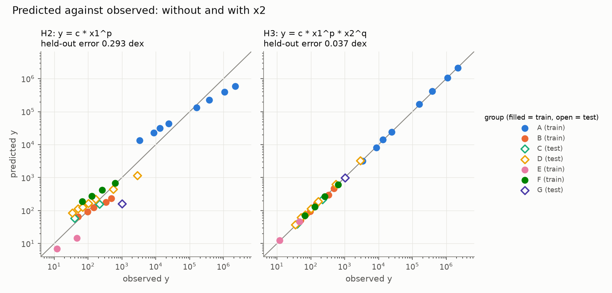

# Lessons

Work through the notebooks in order. Solutions to the challenges are in
[`../solutions`](../solutions). The four parts follow the stages of a study:
propose, fit and predict, test, then report and audit.

| Part | Stage | Question | AI tool | No-key fallback |
| --- | --- | --- | --- | --- |
| [1. Blind Data and Hypotheses](1_Blind_Data_and_Hypotheses.ipynb) | Propose hypotheses | What could the law be? | [Open Coscientist](https://github.com/jataware/open-coscientist) | Prompts by hand in a chat app |
| [2. Evolving a Formula](2_Evolving_a_Formula.ipynb) | Fit and predict | Which formula predicts unseen groups? | [OpenEvolve](https://github.com/algorithmicsuperintelligence/openevolve) | `mini_evolve.py`: a small offline search, no LLM |
| [3. Testing Hypotheses](3_Testing_Hypotheses.ipynb) | Test | Is the evidence strong enough? | None: plain statistics | Always offline |
| [4. Writing and Auditing the Paper](4_Writing_and_Auditing_the_Paper.ipynb) | Report and audit | Can we trust what the AI wrote? | [OpenScience](https://github.com/synthetic-sciences/openscience) | `make_paper.py`: a template paper from the Part 3 results |

What each AI tool adds, and its limit:

- **Open Coscientist:** LLM agents propose, debate and rank hypotheses. A
  ranking is not evidence.
- **OpenEvolve:** an LLM rewrites a formula program and keeps what a score
  function rewards. The score function decides what counts as good.
- **OpenScience:** an agent writes a paper from the results and the
  literature. Fluent writing still has to be checked.

The task: given 29 noisy rows, each with three unnamed quantities (`x1`, `x2`,
`y`), find the law that links them and show that it holds for groups it never
saw. Rows come in 7 groups, labelled A to G; rows in a group share one value
of `x2`. Names are hidden, units are scrambled and noise is added, so the law
must be fitted, not recited from memory. Part 3 reveals what the data are.

## 1-Hour Workshop Schedule

The live session does one challenge per notebook. The others are marked
⏱️ **Take-home** in the notebooks. Setup (DataHub or `uv sync`) is done before
the session starts. Run Part 3 before Part 4: Part 4 reads `lessons/results/`.

| Duration | Part | Live challenge | Demo |
| --- | --- | --- | --- |
| 15 min | 1. Blind Data and Hypotheses | Challenge 2: Score a Hypothesis | Instructor: live with a key; otherwise read the summary in the Part 1 demo cell |
| 15 min | 2. Evolving a Formula | Challenge 1: A Leaky Evaluator | Instructor: `mini_evolve.py` live |
| 10 min | 3. Testing Hypotheses | None: run the cells and show the reveal | None |
| 15 min | 4. Writing and Auditing the Paper | Challenge 1: Check the Interval Claim | Saved OpenScience paper |
| 5 min | Wrap-up | Rules for using AI in research, and questions | None |

## Folder Layout

```
AI-Science-Coscientist/
  lessons/
    1_*.ipynb … 4_*.ipynb  the workshop notebooks
    scripts/               the code the notebooks call
      01_hypotheses/       run_coscientist.py, prompts.md
      02_openevolve/       initial_program.py, evaluator.py, config*.yaml, mini_evolve.py
      03_tests/            hypothesis_tests.py
      04_paper/            goal.md (OpenScience), make_paper.py
      run_all.sh           every step in order, from the command line
    paper/                 example_report.md, openscience_report.md, and the audit (README.md)
    results/               written by Part 3 (not committed)
  solutions/               the challenge solutions, one notebook per part
  data/
    observations.csv       the disguised data: the only data file the AI sees in Parts 1–2
    orbits.csv             the undisguised source data, opened at the reveal
    make_dataset.py        builds observations.csv from orbits.csv
    key.json, reveal.py    how to undo the disguise, used only at the reveal
    literature/            Galileo 1610, Kepler 1619, Newton 1687: citations and quotations
  images/                  figures for the READMEs
```

Part 4 is deliberately not blind: OpenScience also reads `key.json` and the
literature.

## Running the AI Tools

Every notebook runs without a key. With an OpenAI or Gemini key, the demo
cells in Parts 1 and 2 (cells that call an AI tool and are skipped without a
key) also run the AI tools. Part 4 always shows a saved OpenScience run.

Never commit a key. Export it before you start Jupyter:

| Provider | Key variable | Tested | Part 1 `--model` | Part 2 `--config` (model) |
| --- | --- | --- | --- | --- |
| OpenAI (paid) | `OPENAI_API_KEY` | Yes | `gpt-4.1-mini` | `config.openai.yaml` (gpt-4o-mini) |
| Gemini (free tier) | `GEMINI_API_KEY` | No | `gemini/gemini-2.5-flash` | `config.yaml` (gemini-2.5-flash-lite) |
| Anthropic (paid), `run_all.sh` only | `ANTHROPIC_API_KEY` | No | `anthropic/claude-haiku-4-5-20251001` | `config.anthropic.yaml` (claude-haiku-4-5) |

The config files are in `scripts/02_openevolve/`. In the live session, the
instructor runs the demos with one key; students use the no-key path.

On DataHub or Binder, set the key in the first cell without saving it:
`import getpass, os; os.environ['OPENAI_API_KEY'] = getpass.getpass()`.

OpenScience (Part 4) is a Node.js tool: see
[`scripts/04_paper/goal.md`](scripts/04_paper/goal.md).

To run every step without notebooks, from the repo root:

```bash
./lessons/scripts/run_all.sh
```

It writes the results to `lessons/results/` and a paper to
`lessons/paper/report.md`. It runs Open Coscientist and OpenEvolve (Parts 1–2)
if a key is exported. Part 4 always uses the template; for OpenScience see
`scripts/04_paper/goal.md`. If several keys are set, OpenAI is used first,
then Anthropic, then Gemini.

## Troubleshooting

| Symptom | Fix |
| --- | --- |
| `uv: command not found` | Install uv: see the [uv installation guide](https://docs.astral.sh/uv/getting-started/installation/). On macOS or Linux: `curl -LsSf https://astral.sh/uv/install.sh \| sh` |
| HTTP 429, "requests per day" | Rate limit. New OpenAI accounts can be capped at 50 requests a day per model. Wait, switch model, or use the fallback. |
| HTTP 429, "no credits remaining" | Add credits on the provider's billing page. |
| Anthropic 400, "not scoped to a workspace" | Create the key inside a workspace in the Anthropic Console. |
| `ImportError` from `mcp` | Install with `uv sync`, which pins `mcp<2`. |

## Sources and Licences

- `data/orbits.csv`: NASA planetary and satellite fact sheets. Every row
  agrees with the law the workshop recovers to within 1%.
- `data/literature/`: public-domain editions, linked there.
- Open Coscientist: MIT with Commons Clause. OpenEvolve and OpenScience:
  Apache 2.0.

## Answer Key (Read After Part 3)

<details>
<summary>Spoilers: open after Part 3</summary>

The data are real orbits: `x1` is the semi-major axis `a`, `x2` is the mass of
the central body `M`, and `y` is the orbital period `T`. Each group is one
central body. The law is Kepler's third law with Newton's mass term,
`T = 2π √(a³ / GM)`.

### Results

From Part 3, on the committed data:

| Hypothesis | Formula | Held-out error (dex) |
| --- | --- | --- |
| H1 | `y = c * x1` | 0.245 |
| H2 | `y = c * x1^p` (no x2) | 0.293 |
| H3 | `y = c * x1^p * x2^q` | 0.037 |
| H4 | `y = c * x1^(3/2) * x2^(-1/2)` (Newton's form) | 0.036 |

Error is in dex: the mean absolute error of log10(y) on the held-out groups
C, D and G, which the least-squares fits in Part 3 never see. 0.036 dex is about 9%; 0.29 dex is about
a factor of 2. Without x2, one constant cannot fit every group, so H2 does no
better than H1.

- **Exponents:** p = 1.506 and q = −0.507. Their 95% bootstrap intervals
  (resampling whole groups) contain 3/2 and −1/2.
- **x2 matters:** a group-level test (one point per group, 7 groups) rejects
  "x2 has no effect" with p-value = 1.3e-09. A row-level F-test gives
  p-value = 3e-29, which overstates the evidence because rows in a group share
  one x2.
- **G:** 7.256e-11 m³ kg⁻¹ s⁻², which is 8.7% above the accepted 6.674e-11.
  Most of the gap comes from the 10% noise added to each group's x2.
- **Resampling unit matters:** the interval for G from resampling rows,
  [6.899e-11, 7.630e-11], misses the accepted value. Resampling whole groups
  gives [6.591e-11, 7.892e-11], which contains it. The row interval is too
  narrow because rows that share one mass estimate are not independent.
  Resample the unit that carries the error.



### What the AI Tools Did in Our Test Runs

One run each, with an OpenAI key.

| Part | Model | Outcome |
| --- | --- | --- |
| 1. Open Coscientist | `gpt-4.1-mini` | Completed in 96 s. Its top-ranked hypotheses were power laws with the wrong sign on the `x2` exponent (+0.5; the data say −0.5). |
| 2. OpenEvolve | `gpt-4o-mini` | Score (higher is better; 1 / (1 + held-out error)) rose from 0.803 to 0.964, a held-out error of 0.037 dex, the same as H3: a least-squares power law fitted from the data. Only 10 of 30 iterations ran because of a rate limit. OpenEvolve's score used these same groups, so its 0.037 dex is not an independent test. |
| 4. OpenScience | `gpt-4.1-mini` | Wrote a paper in 40 s. Its tables were correct, but the text had six errors, including the main one: it said the row-resampling interval for G contains the accepted value. Audit in [`paper/README.md`](paper/README.md). |

In these single runs, Open Coscientist's debate-and-rank step put a wrong
hypothesis first. The held-out score separated laws with and without x2, and
simplicity chose H4 over H3. The fluent write-up still needed checking line by
line. Your runs may differ: compare them with ours.

</details>
